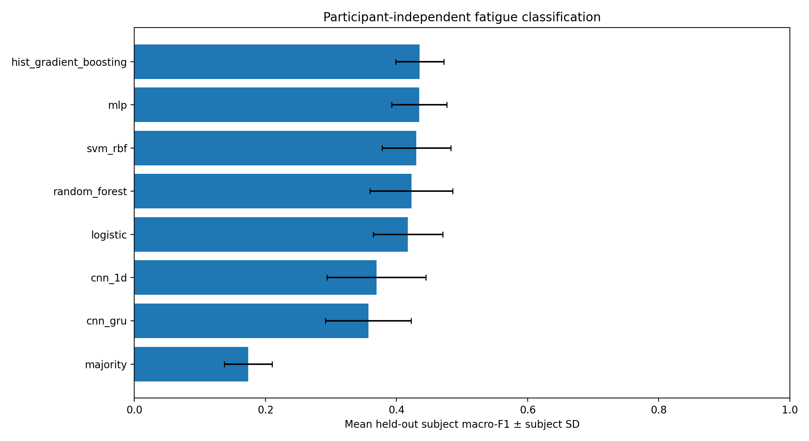
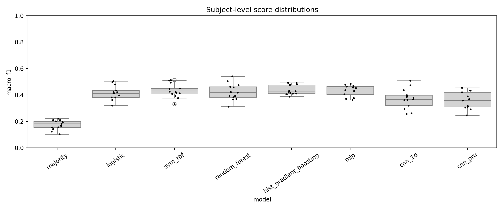
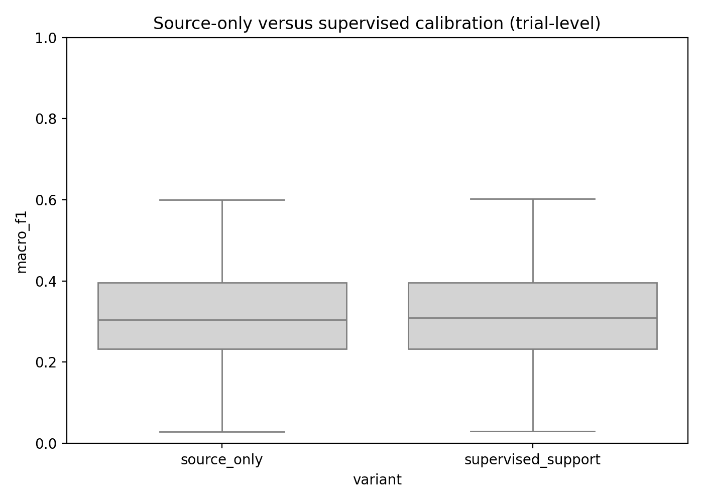
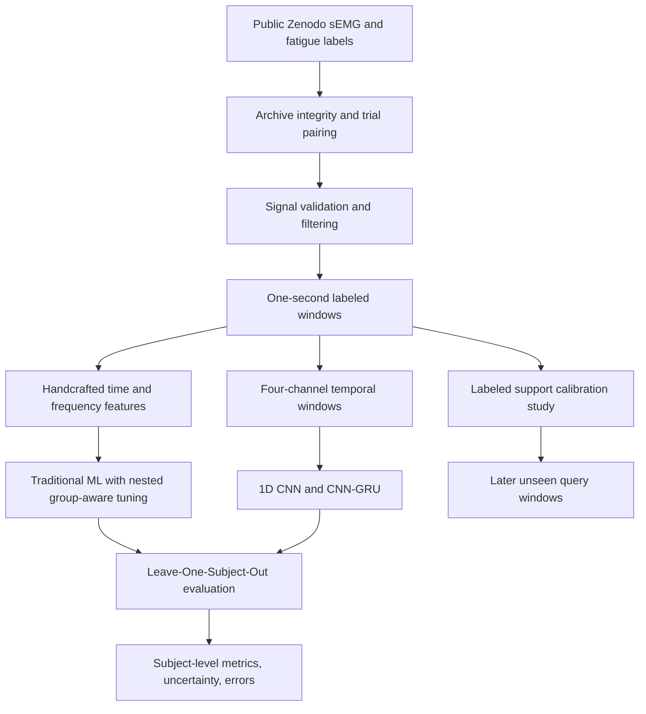
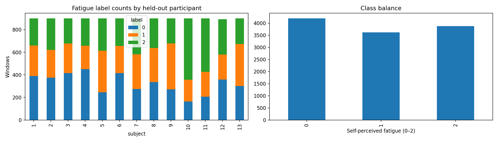
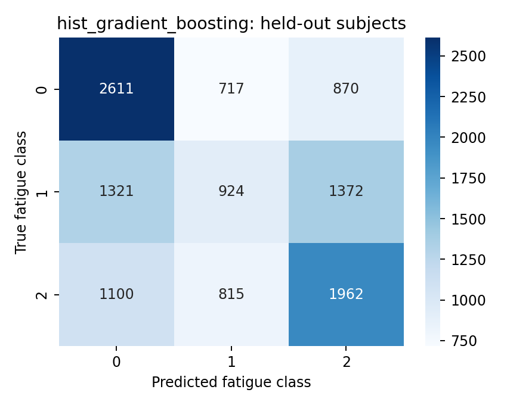

<div align="center">

# EMG Fatigue AI

### Participant-Independent Muscle Fatigue Classification from Surface Electromyography

**Signal Processing · Machine Learning · Deep Learning · Reproducible AI Research**

[Research Notebook](notebooks/EMG_Fatigue_Research.ipynb) · [Technical Report](docs/EMG_Fatigue_Research_Report.docx) · [Experiment Results](results/all_model_summary.csv) · [Dataset](https://zenodo.org/records/14182446)

</div>

---

## Overview

EMG Fatigue AI is a reproducible research project investigating whether three levels of **self-perceived muscular fatigue** can be classified from multichannel surface electromyography (sEMG) signals of **previously unseen participants**. The study implements rigorous signal quality checks, trial-aware windowing, traditional ML baselines, neural sequence models, participant-held-out evaluation, feature ablations, and an exploratory supervised personalization experiment.

> **Research project, not a medical diagnostic device.** The target is a subjective fatigue rating; model predictions are not a clinical assessment of muscle function.

## Research at a glance

| Item | Executed experiment |
|---|---|
| Participants | **13** |
| Matched participant/trial recordings | **156** |
| Eligible labeled windows | **11,692** |
| Fatigue categories | **3** (labels 0, 1, 2) |
| Evaluation | **Leave-One-Subject-Out** (LOSO), 13 held-out participants |
| Primary metric | Subject-averaged **macro-F1** |
| Strongest tested model | Histogram Gradient Boosting (**0.4354 macro-F1**) |
| Majority-class baseline | **0.1737 macro-F1** |

**These are dataset-specific experimental results, not a general clinical performance guarantee.** Scores are averaged across held-out subjects; overlapping windows are not treated as independent individuals.

## Results



| Model | Mean subject macro-F1 | Mean balanced accuracy |
|---|---:|---:|
| Histogram Gradient Boosting | **0.4354** | **0.4627** |
| Multilayer Perceptron | 0.4344 | 0.4610 |
| RBF Support Vector Machine | 0.4301 | 0.4544 |
| Random Forest | 0.4226 | 0.4555 |
| Logistic Regression | 0.4173 | 0.4515 |
| 1D CNN | 0.3693 | 0.4110 |
| CNN–GRU | 0.3569 | 0.3926 |
| Majority baseline | 0.1737 | 0.3333 |

The classical feature-based models outperformed the tested neural architectures under **this specific participant-independent protocol**. This is a meaningful research observation—not an indication that deep learning cannot perform well with other datasets, architectures, or training budgets.



### Supervised subject-specific calibration

An additional experiment used **labeled early windows** from the target participant and evaluated predictions on later windows after a temporal embargo. The observed macro-F1 changed from **0.3121** (source-only) to **0.3104** (supervised-support). This experiment **did not demonstrate improvement** in macro-F1 and is reported transparently as such.



## Methodology



1. **Data provenance and auditing:** Acquire the published Zenodo archive, verify file identity, pair fatigue ratings with EMG trials, and record exclusions.
2. **Signal preprocessing:** Apply a 20–450 Hz Butterworth band-pass filter and 50 Hz notch filter; zero-phase filtering is used for **offline** research, not demonstrated live inference.
3. **Window extraction:** Use one-second windows with a 0.5-second hop and require at least 80% within-window label agreement.
4. **Feature engineering:** Build time- and frequency-domain descriptors alongside standardized multichannel waveform inputs.
5. **Model comparison:** Evaluate classical models and compact CNN/CNN–GRU architectures on held-out participants. Inner hyperparameter search for classical models uses training-side groups only.
6. **Analysis:** Export confusion matrices, class-level errors, between-subject variability, ablations, and participant-level uncertainty estimates.

## Additional analysis

| Distribution and errors | Diagnostic figures |
|---|---|
| Class balance |  |
| Gradient boosting confusion matrix |  |

Further figures and raw summary tables are available in [`assets/figures`](assets/figures) and [`results`](results).

## Technology stack

**Python · NumPy · Pandas · SciPy · scikit-learn · PyTorch · Matplotlib · Google Colab · Signal Processing · ML/DL · Cross-Validation**

## Reproduce the study

1. Open [`notebooks/EMG_Fatigue_Research.ipynb`](notebooks/EMG_Fatigue_Research.ipynb) in Google Colab.
2. Run cells from the beginning in order. The notebook documents its dependency installation and reproducibility configuration.
3. The source dataset is fetched from [Zenodo record 14182446](https://zenodo.org/records/14182446); no original participant recordings are republished here.
4. Use notebook-generated results for comparison with the **supplied executed snapshot**, noting that runtime, package versions, or dataset availability may affect reproducibility.

The notebook can be computationally demanding, especially across 13 LOSO folds; the bundled figure and CSV files are an **exported result snapshot**, not proof that this GitHub repository was re-executed after publication.

## Repository structure

```text
emg-fatigue-ai/
├── README.md
├── notebooks/
│   └── EMG_Fatigue_Research.ipynb
├── docs/
│   └── EMG_Fatigue_Research_Report.docx
├── assets/figures/
│   ├── all_model_comparison.png
│   ├── subject_score_distributions.png
│   ├── adaptation_comparison.png
│   └── ...
└── results/
    ├── all_model_summary.csv
    ├── adaptation_summary.csv
    ├── experiment_configuration.json
    └── ...
```

## Limitations and responsible interpretation

- Fatigue categories are **self-perceived ratings**, not verified medical fatigue diagnoses.
- All results arise from **one public cohort of 13 participants** with a limited protocol.
- Correlation among overlapping windows and class imbalance complicate interpretation.
- Labeled support calibration is **supervised**, not zero-shot personalization.
- Zero-phase filters and runtime measurements do **not** establish real-time deployment readiness.
- Clinical or safety-critical use would require independent external validation and substantial additional research.

## Data attribution

Cerqueira, S., Vilas-Boas, R., Figueiredo, J., & Santos, C. (2024). *A Dataset of sEMG and Self-Perceived Fatigue Levels for Muscle Fatigue Analysis* (Version 2). Zenodo. https://doi.org/10.5281/zenodo.14182446

**Portfolio case study and reproducible research implementation.** See the accompanying report for further methodology, results, and literature references.
